<!--
  Brand: KruxSYS palette and marks, see docs/brand.md.
  Note for maintainers: the Plexdio logo currently served on kruxsys.com
  (assets/img/plexdio/logo-128.*.webp) is still the old amber icon. The current logo is
  assets/brand/plexdio.svg; the site asset should be replaced with a render of it.
-->
<p align="center">
  
</p>

<h1 align="center">Plexdio</h1>

<p align="center">
  <a href="https://kruxsys.com/"></a>
  &nbsp;by <a href="https://kruxsys.com/"><b>KruxSYS</b></a>
</p>

<p align="center"><b>A small, native Windows music player for Plex.</b></p>

<p align="center">
  <a href="https://kruxsys.com/projects/plexdio/"></a>
  <a href="https://kruxsys.com/projects/plexdio/"></a>
  <a href="https://kruxsys.com/"></a>
  <a href="https://plexdio.kruxsys.com/download"></a>
  <a href="https://plexdio.kruxsys.com/changelog"></a>
  
</p>

<p align="center">
  <a href="https://plexdio.kruxsys.com">Website</a> ·
  <a href="https://plexdio.kruxsys.com/download">Download</a> ·
  <a href="https://plexdio.kruxsys.com/docs">Docs</a> ·
  <a href="https://kruxsys.com/projects/plexdio/">Project page</a> ·
  <a href="https://kruxsys.com/">kruxsys.com</a> ·
  <a href="https://github.com/KruxSYS/plexdio">Source</a>
</p>

Plexdio is a small, native Windows 10/11 x64 music player for Plex, a lean alternative to Plexamp.
It is one self-contained exe (about 25 MB, most of it Ride's beat-tracking model) with no
runtime and no Electron, shipped as an **installer** and a **portable zip** on
[plexdio.kruxsys.com](https://plexdio.kruxsys.com/download), and it keeps itself up to date.

*Formerly **Plexify**, then briefly **PlexDio**. Settings, the library cache, the saved sign-in and the start-with-Windows
entry carry over automatically on first start.*

> **Status: in development.** Plexdio has been tested against its own mock Plex server under
> Wine and on a Windows 11 VM. It has never talked to a real Plex server or plex.tv. Cast is
> experimental. Real audio output has not been checked: there is no audio device in Wine or the
> test VM. See [Status](#status) for the details.

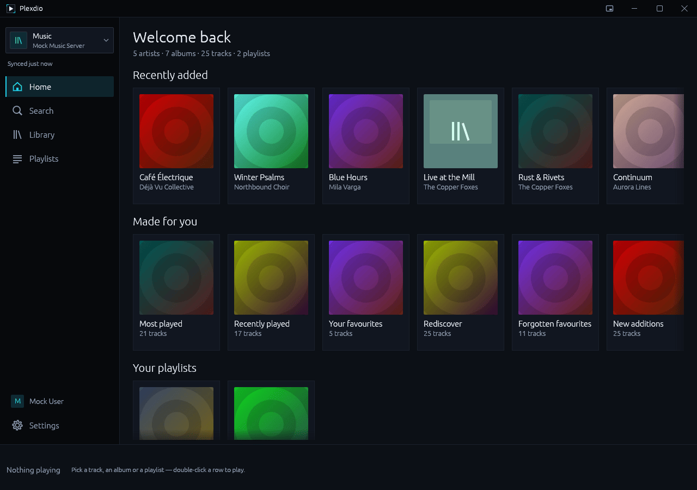

| Album | Artist |
|---|---|
| 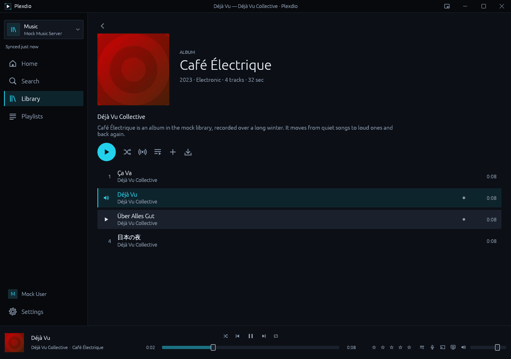 | 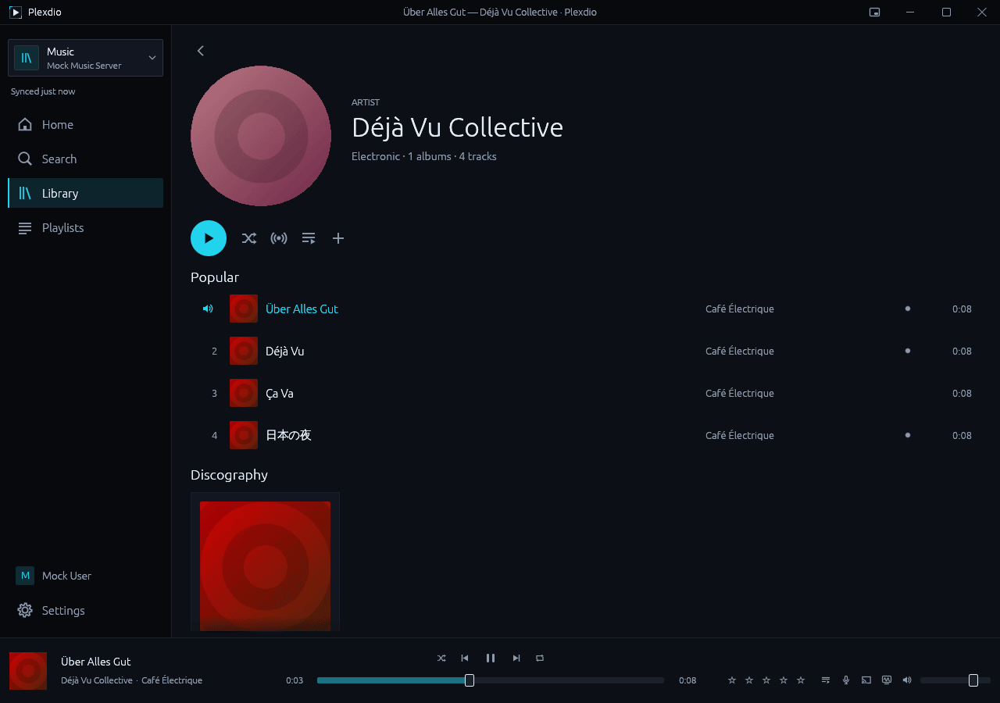 |
| **Radio** | **Search** |
| 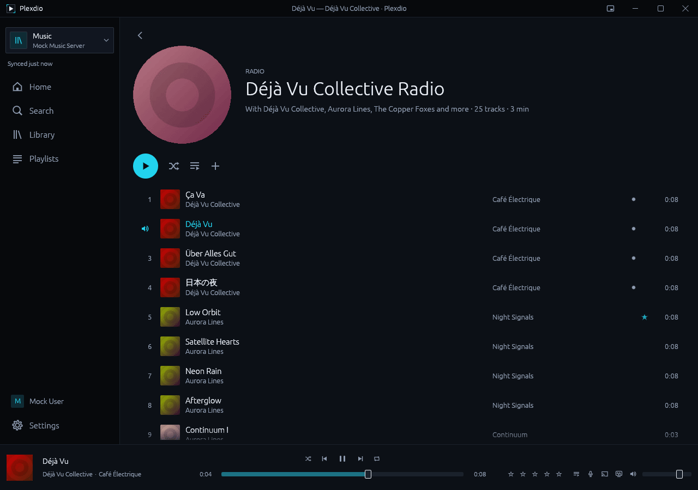 | 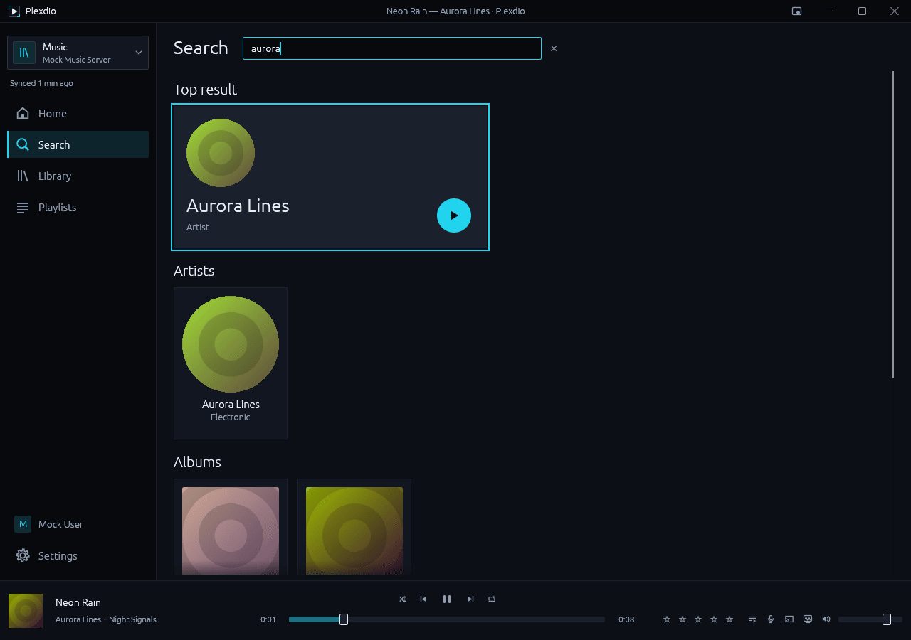 |
| **Settings** | **About** |
| 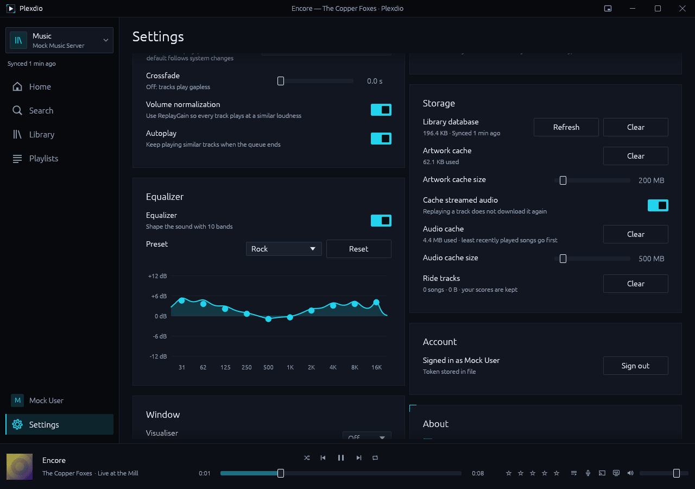 | 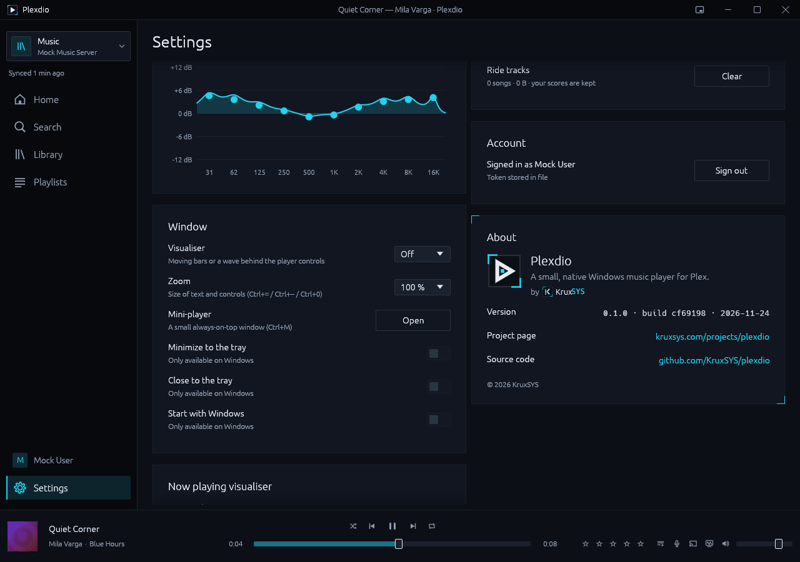 |

Sign-in and mini-player:

| | |
|---|---|
| 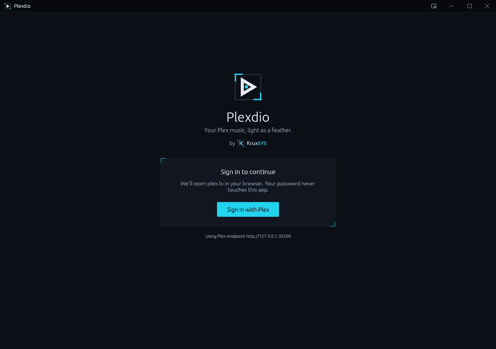 |  |

Now playing visualiser (`V`, `F11` for full screen):

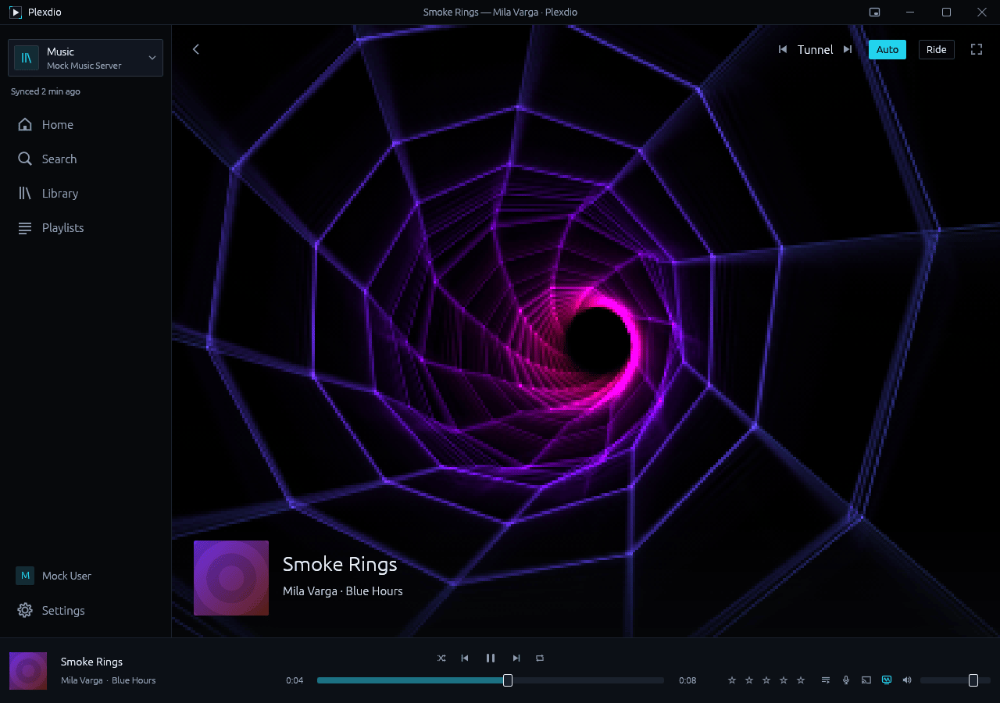

Its nine retro looks, inspired by the Xbox dashboard, Windows Media Player and the PlayStation's
Sound Scope:

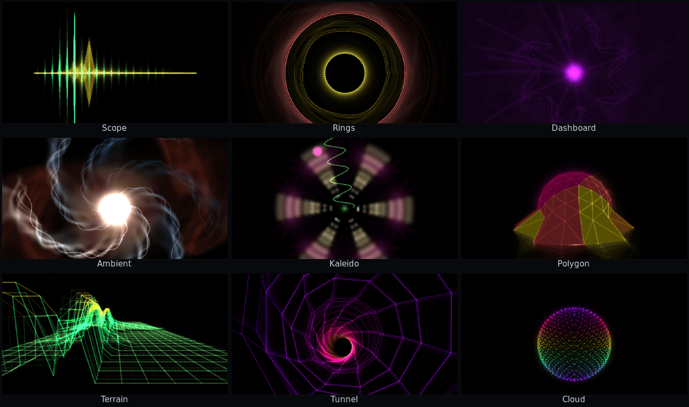

**Ride**, an Audiosurf-style game on the song that is playing (`G` on the Now playing page; see
[Ride](#ride-the-game)):

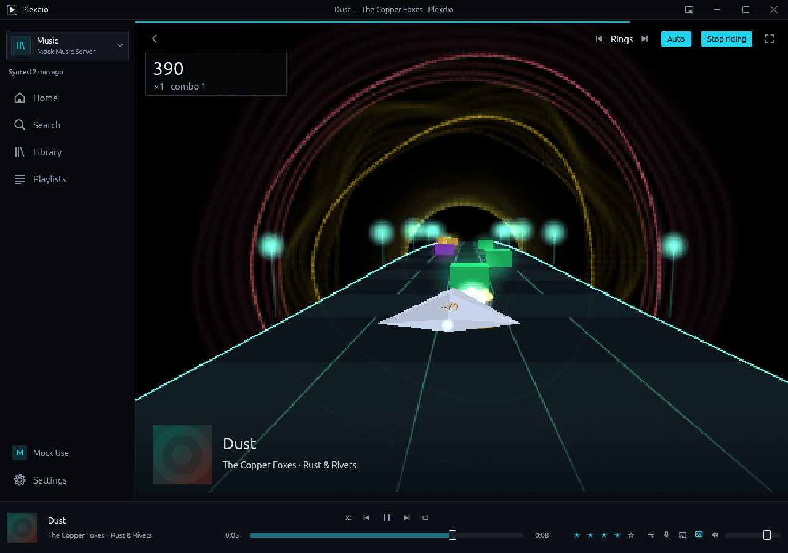

## What it does

- **Sign in** with the Plex PIN flow: the code is shown in the app, the browser opens the
  plex.tv page, and the token is stored in the Windows Credential Manager (DPAPI-encrypted
  file as a fallback).
- **Pick a server and library**: every connection of a server is raced and ranked
  (local > remote > relay), dead connections are skipped, the choice is remembered. The
  sidebar shows the open library and server and switches between them.
- **Offline-first library**: a per-server SQLite cache with a full and a delta sync
  (`updatedAt>>=`/`addedAt>>=` plus a count-check sweep). The UI opens the cached library
  immediately, even with the server unreachable.
- **Browsing**: Home (recently added, **Made for you** mixes, playlists), Artists / Albums /
  Tracks / Genres, artist/album/playlist pages, virtualised lists that stay smooth with
  100 000 tracks. Artist pages scroll as one page: Popular, Discography, **Fans also like**
  (similar artists from the server's related hubs, or genre matches from your library) and
  the artist's bio; album pages show the album's description.
- **Made for you**: Most played, Recently played, Your favourites, Rediscover, Forgotten
  favourites, New additions, Deep cuts, and mixes for your top genres and decades. Each opens
  as its own page, like a playlist.
- **Library sorting and filters**: sort by name, artist, year, date added, plays or rating
  (reversible); filter chips for Unplayed, Downloaded, rating, decade and genre; an A–Z jump bar
  for name order. The choices are remembered.
- **Playlist editing**: create, rename and delete playlists; *Add to playlist* from any song's
  right-click menu, the selection, or an album/mix/playlist page (with a prompt for songs
  already in it); remove songs and drag them into a new order. Smart playlists stay read-only.
- **Multi-select**: click, `Ctrl`+click, `Shift`+click and `Ctrl+A` in any song list; a bar and
  the right-click menu play, queue, add to a playlist or remove the selection.
- **Instant search**: in-memory, diacritic-folding prefix/substring search over artists,
  albums, songs, playlists and genres with a **Top result**, plus a server `/hubs/search`
  supplement. `Ctrl+F`; `↑`/`↓` move through the results, `Enter` opens (or plays) and
  `Shift+Enter` adds to the queue.
- **Lyrics**: a side panel with the server's lyrics (sidecar `.lrc`/`.txt`, or LyricFind with
  Plex Pass). Time-synced lyrics follow the song, centred on the current line; click a line to
  jump there. Lyrics are cached, so they also show offline.
- **Track info**: format, bitrate, sample rate/bit depth, channels, size, file path, plays,
  dates and ReplayGain, and for the playing song how it plays (original or converted, and any
  resampling).
- **Downloads for offline listening**: keep albums, playlists, mixes or single songs on this
  computer in original quality (Opus as 320 kbps MP3, which the player can decode). Downloaded
  playlists follow changes on the server. Downloaded songs play without a connection; plays made
  offline are reported once the server is back. Optional: download only on the home network.
- **Cast** (experimental): play on other Plex players on your account or server (Plexamp, Plex
  apps), several at once if you like. The now-playing bar shows and controls what they play;
  *This computer* takes the music back where they were.
- **Playback**: gapless and crossfade (0–12 s), ReplayGain/loudness normalisation, a
  **10-band equaliser** with presets, seek, volume, mute, prefetch and an on-disk audio
  cache. Codecs are decoded in-process with Symphonia (MP3, FLAC, AAC/M4A, ALAC, Vorbis,
  WAV); anything else — and Opus — goes through the server's universal transcoder. A dropped
  connection mid-song reconnects and resumes the download where it stopped (HTTP `Range`).
- **Now-playing bar**: Spotify-style three columns that fit any window width. Click the
  cover, title or album to open the album, the artist to open the artist. In track lists, a
  single click on the hover play icon plays the song (double-click a row still works).
- **Queue**: add next / add to queue, drag reorder, remove, clear, shuffle (weighted by rating
  and play count, artist-spread) and repeat off/all/one. The queue, track and position
  resume on the next start.
- **Radio and autoplay**: start a station from a track, artist or album; it opens on its own
  **Radio page** listing the station's tracks ("With A, B, C and more"). Sources: sonic
  `nearest` when the server offers it, else same artist/genre from the cache. When the queue
  runs out, autoplay picks up from the last track.
- **Reporting**: `/:/timeline` while playing (every 10 s and on state changes), `/:/scrobble`
  at 90 %, and star ratings through `/:/rate`.
- **Discord Rich Presence** (optional): your Discord status shows "Listening to Plexdio" with
  the song, artist, album cover and a progress bar while music plays; pausing clears it. See
  [Discord setup](#discord-setup).
- **Visualiser** (optional): spectrum bars or a waveform behind the player controls and along
  the mini-player, from the audio actually being heard.
- **Now playing visualiser**: a full-window (or full-screen, `F11`) page with nine retro looks in
  the style of the original Xbox dashboard, Windows Media Player 7–10, the PlayStation's Sound
  Scope and the console light synths: Scope, Rings, Dashboard, Ambient, Kaleido, Polygon,
  Terrain, Tunnel and Cloud. Low-resolution feedback effects and simple 3D, reacting to bass,
  mid, treble and beats; they change by themselves on a beat (or with `↑`/`↓`). The song's cover
  and title fade in on track changes, Xbox style. On pause the picture fades out (the Dashboard
  into a starfield) and drawing stops. Open it with the bar's visualiser button or `V`; `A`
  toggles the automatic changes, a double-click or `F11` toggles full screen, `Esc` leaves.
  Settings → Now playing visualiser picks the look, change interval, resolution, sharp or smooth pixels,
  dithering and frame rate. The picture is scaled straight into the window, so full screen costs
  about a quarter of one CPU core.
- **Ride**: an Audiosurf-style game on the song that is playing, built from the song itself and
  played over the visualiser. See [Ride](#ride-the-game).
- **Zoom**: 80–150 % (`Ctrl+=`, `Ctrl+−`, `Ctrl+0`, or Settings), remembered.
- **Windows integration**: an exe with the KruxSYS version information, a themed title bar (drag, double-click to maximise, resize from any
  edge, live redraw while resizing), tray icon with menu, minimise/close to tray, media keys
  (`RegisterHotKey`, plus the System Media Transport Controls media overlay with metadata,
  status and seek timeline), start with Windows, a compact always-on-top mini-player (no
  title bar; drag it anywhere), windows that come back on screen by themselves when a
  resolution change, an unplugged monitor or waking from sleep strands them, and keyboard
  shortcuts (`Space`, arrows, `Ctrl+←/→`,
  `Ctrl+↑/↓`, `Ctrl+M`, `Ctrl+F`).
- **Settings**, as cards of rows with switches: streaming quality (original or a bitrate cap
  via the transcoder), crossfade, normalisation, autoplay, the equaliser, window behaviour,
  Discord, zoom, visualiser, downloads, image and audio cache sizes with usage and clear
  buttons, account/sign-out, and **About** (version and build, links to the project page and
  the source). Two columns on wide windows, one on narrow ones.
- **Look**: the KruxSYS style, with dark navy panels, thin blue-grey lines, a cyan accent and
  square corners. [docs/brand.md](docs/brand.md) lists every colour, where it comes from and
  the contrast checks; `tools/make_icons.py` renders the icons from
  [`assets/brand/plexdio.svg`](assets/brand/plexdio.svg).

### Equaliser

Ten peaking filters (31 Hz – 16 kHz, one octave apart, ±12 dB) on the final mix, with presets
(Flat, Bass boost/reducer, Treble boost, Vocal, Rock, Pop, Jazz, Classical, Electronic,
Loudness). The editor draws the filters' real combined frequency response; drag a handle to
change a band, double-click it to reset it. Changes are heard immediately and saved when you
let go. To avoid clipping, the mix is pre-cut by half of the largest boost, then limited.
With the equaliser off or flat it is bypassed completely (bit-exact output).

### Discord setup

Plexdio can show what you are listening to on your Discord profile ("Listening to Plexdio",
with the song, artist, album and a progress bar). Discord needs an *application* for that,
which you create once for free; it takes about two minutes.

1. Open the [Discord Developer Portal](https://discord.com/developers/applications) and sign in
   with your Discord account.
2. Click **New Application**, name it **Plexdio** (this name is what your status shows after
   "Listening to"), accept the terms and click **Create**.
3. On the **General Information** page, click **Copy** under **Application ID**.
4. *Optional, for the Plexdio logo:* open **Rich Presence → Art Assets**, click
   **Add Image(s)**, upload [`assets/discord-icon.png`](assets/discord-icon.png) (or any square
   image of at least 512×512), set its name to `plexdio` exactly, and click **Save Changes**.
   New images can take a few minutes to show up. The logo appears as a small badge on the
   album cover, or on its own when no cover is found.
5. In Plexdio open **Settings → Discord**, paste the ID into **Application ID**, and switch on
   **Show what I'm listening to**.
6. Keep the Discord desktop app running and play a song; your status appears within a few
   seconds. Pausing or stopping clears it.

If nothing shows up, check that *Discord → User Settings → Activity Privacy → Share your
detected activities with others* is on, and that you use the desktop app (the browser version
cannot see other apps).

**Album covers.** Discord can only show pictures from the public internet, and your Plex
artwork lives on your own server behind your Plex token, which Plexdio never shares. So the
cover is looked up by artist and album name on [Deezer](https://www.deezer.com) and, if that
finds nothing, Apple's iTunes Search; only an exact artist and album match is used, so you see
the logo rather than a wrong cover. This sends the artist and album names (nothing else) to
those services; turn off **Settings → Discord → Album covers** to keep them local.

The setting is off by default because it shares your listening activity. Plexdio talks to the
Discord desktop app over its local IPC pipe, retries every 15 s while Discord is closed, and
stays within Discord's rate limit (5 updates per 20 s). For a build with a built-in ID, put
it into `CLIENT_ID` in `crates/plexdio/src/discord.rs`; `PLEXDIO_DISCORD_CLIENT_ID` also
works for testing. An ID entered in Settings always wins.

## Ride (the game)

Ride turns the song that is playing into a road, in the spirit of Audiosurf. Press `G` (or the
**Ride** button) on the Now playing page at any point in a song: the music never stops, the road
is ready in about a second, and the ride carries on from song to song until you stop it.

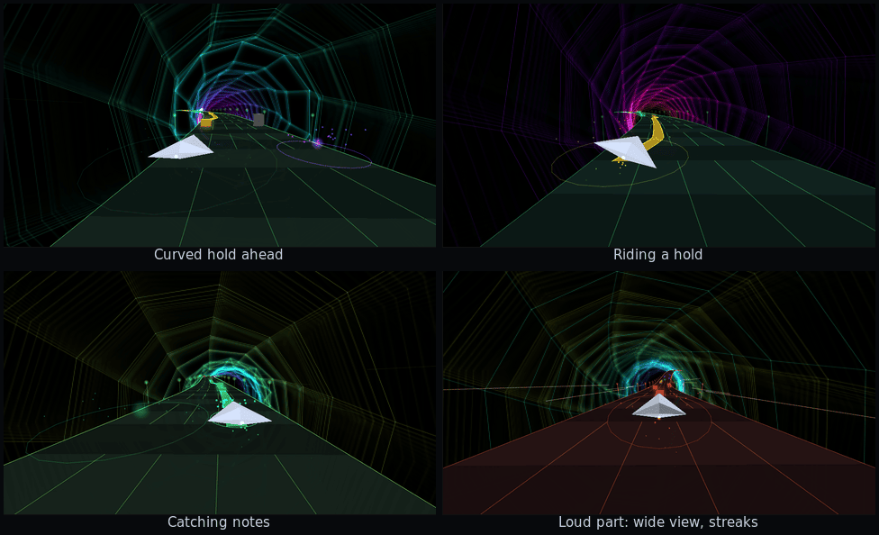

### How to play

- **Steer** with the mouse (its position across the view) or `←`/`→`. The cursor hides over the
  game only.
- **Catch** the coloured blocks in the five lanes. Hot colours (red, yellow) are worth more than
  cool ones (blue, violet). A run of catches builds a **combo**: ×2 at 10, ×3 at 25, ×4 at 50.
- **Avoid** the grey blocks: they cost points and break the combo.
- **Hold notes** are glowing ribbons. Catch the head and stay on the ribbon to earn points as you
  go, plus a bonus at the end. Some ribbons **curve** into the next lanes, following the music;
  follow them. Leaving a hold early breaks it but keeps your combo.
- You can't fail: every ride goes to the end of the song. Each song ends with a results card
  (score, accuracy, best combo, and your personal best for that song and level).
- `Esc` stops riding. Restarting the song (Previous, or seeking to the start) rides it again.

### How the road is made

- **Analysis** (about a second, in the background, while the music plays): note starts in three
  bands (bass, mids, highs), sustained sounds, loudness and the song's sections. A steady beat
  grid comes from a classic beat tracker, refined a few seconds later by the **Beat This!** AI
  model (ISMIR 2024), which is built into the exe and runs on the CPU at low priority.
- **The road** climbs slowly through calm parts and drops fast through loud ones, turning at
  section changes. Its speed follows the music: from 0.6× in calm parts to 1.5× in the loudest,
  where the view widens, the camera drops and streaks rush past.
- **Notes** sit on beats (and half- or quarter-beats on harder levels) where the song has a note
  start. Each band gets a home lane per section and walks around it, and every four bars the
  layout mirrors. Sustained sounds become holds; notes played over them become a hold's curves.
- Tracks and scores are kept in the library database, so a song you've ridden loads instantly.
  The next song in the queue is prepared while you ride.

### Settings

Settings → **Ride**: difficulty (Casual, Pro, Elite: more notes, more curves and a faster road;
scores are kept per level), what you ride in, 30 or 60 fps, an audio delay for wireless
headphones, and the AI beat model on or off. Settings → Storage → **Ride tracks** shows the saved
tracks and clears them (your scores stay).

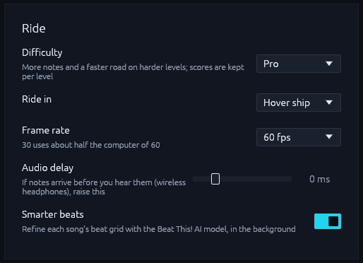

Ride in a hover ship, a car or a plane:

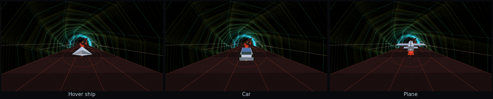

## Install, update and uninstall

Download from **[plexdio.kruxsys.com/download](https://plexdio.kruxsys.com/download)** (Windows 10/11 x64).
Both packages hold the same `plexdio.exe`; the files are not code-signed, so SmartScreen may warn on first
start (*More info → Run anyway*; the download page lists each file's SHA-256).

| | **Installer** `Plexdio-<ver>-win-x64-setup.exe` | **Portable zip** `Plexdio-<ver>-win-x64-portable.zip` |
|---|---|---|
| Installs to | `%LOCALAPPDATA%\Programs\Plexdio`, per user, no admin rights (all users offered when elevated) | Any folder: unzip and run `Plexdio\plexdio.exe` |
| Marker next to the exe | `installed` (written by the setup) | `portable` (in the zip) |
| Settings, queue | `%APPDATA%\Plexdio` | `Data\config` next to the exe |
| Library cache, play history, Ride, artwork/audio cache, downloads, logs, model | `%LOCALAPPDATA%\Plexdio` | `Data\cache` next to the exe |
| Plex sign-in | Windows Credential Manager ("Plexdio") | the same |
| Start menu, Add/Remove Programs (publisher KruxSYS) | yes, plus an optional desktop icon | no |
| Updates | downloads the new setup, checks SHA-256, runs it silently, restarts | downloads the new zip, checks SHA-256, swaps `plexdio.exe`, restarts |
| Uninstall | Settings → Apps; keeps settings and caches | delete the folder |

A bare `plexdio.exe` without a marker (older downloads, dev builds) is shown as *Standalone exe*: it
uses the same profile folders as an installed copy, so existing users keep their data, and its update
button opens the download page. `PLEXDIO_HOME` still overrides everything for test runs. The mode
is resolved in `paths.rs` (`paths::resolve`, unit-tested).

**Backup:** quit Plexdio (tray → Quit) and copy `%APPDATA%\Plexdio` and, for play history, Ride
scores and downloads, `%LOCALAPPDATA%\Plexdio\db` and `…\offline`; a portable copy is backed up by
copying its folder. The sign-in is not part of a backup.

**Updates.** About 10 s after start and then at most once a day (the time is kept in the config),
Plexdio asks `https://plexdio.kruxsys.com/api/v1/version?channel=stable&current=<ver>&arch=<x64|x64-setup>`
with the user agent `Plexdio/<ver>`, Screvia's endpoint and format. It compares versions with
semver itself. A newer release shows a slim banner, a dot on Settings and a section in
**Settings → About** (mode, last check, *Check for updates*, *Automatically check for updates* (on by
default), channel, release notes link, *Update now*). Downloads are rejected unless size and SHA-256
match the manifest. A failed update offers the download page. Automatic checks fail silently (logged
only); nothing blocks start-up or playback. `--update-url URL` or `PLEXDIO_UPDATE_URL` points the app at
another server (staging, `mockplex --releases`). Privacy: [plexdio.kruxsys.com/privacy](https://plexdio.kruxsys.com/privacy).

## Status

**In development.** Tested against **mockplex**, the mock Plex server in this repository, under
Wine and on a real Windows 11 VM. **It has never talked to a real Plex server or plex.tv.** Cast
is experimental, and real audio output has not been checked (there is no audio device in Wine or
the test VM).

| Area | Verified |
|---|---|
| Cross-build, PE32+ x86-64, system-DLL-only imports | ✅ every build (`./build.sh`) |
| PIN sign-in, token storage, server/library selection | ✅ mock server, Wine + Windows 11 |
| Full/delta sync, offline start from cache, 100 000 tracks | ✅ mock server, Wine + Windows 11 |
| Browsing, artwork, virtualised scrolling, search | ✅ Wine + Windows 11 screenshots |
| Gapless, crossfade, gain, seek, prefetch | ✅ sample-accurate unit/integration tests |
| Equaliser (response, bypass, presets, editor) | ✅ unit tests + Wine (editor, saved settings) |
| Download reconnect after a dropped connection | ⚠️ code review only (no fault-injection test yet) |
| Queue, shuffle/repeat, resume, timeline/scrobble/rating | ✅ tests + mock request log |
| Radio page, autoplay, Home mixes, Fans also like | ✅ mock server (sonic on and off) + Wine |
| Playlist editing (create/add/move/remove/rename/delete) | ✅ integration tests + Linux build against the mock |
| Multi-select, library sorts/filters/jump bar, search keys | ✅ unit tests + Linux build against the mock |
| Lyrics (LRC/TXT/JSON parsing, synced panel, cache) | ✅ unit tests + mock lyric streams |
| Downloads (pins, resume, offline play, pending scrobbles) | ✅ integration tests + Linux build offline; download on Windows 11 VM |
| Cast / multi-cast (discovery, play queue, commands, timeline) | ✅ against the mock's fake players only |
| Visualiser, zoom, track info | ✅ unit tests + Linux build screenshots |
| Ride (analysis, AI beats, maps, steering, scores, carry-on, settings) | ✅ unit tests on synthetic drums, preview tool on real songs, Linux build + Windows 11 VM against the mock (60 fps; Beat This! ~2 % of song length) |
| Now playing visualiser (9 looks, full screen, pause fade) | ✅ unit tests, preview tool, Linux build, Windows 11 VM full screen (~26 fps, ~24 % of a core) |
| Discord Rich Presence protocol | ✅ test against a fake Discord socket; Wine (no Discord → retries quietly) |
| Themed title bar, mini-player, settings layout, KruxSYS look | ✅ Wine screenshots; Windows 11 VM (every page, tray and taskbar icons on light and dark taskbars, exe version info) |
| Off-screen window rescue (display change, sleep) | ✅ unit tests + Windows 11 VM (window pushed to 5000,5000 came back in 3 s) |
| Settings persistence, tray, media keys, shortcuts | ✅ Wine |
| SMTC overlay (metadata, status, timeline, buttons) | ✅ Windows 11 VM |
| Real audio output | ❌ no audio device in Wine or the VM (null sink path) |
| Real Discord client, Windows live-resize, title bar drag/snap on Windows | ❌ not checked on a real Windows desktop yet |
| Real Plex account, real server, Plex Pass sonic data | ❌ not available in this environment |

## Build

Requirements: Rust stable with the `x86_64-pc-windows-gnu` target and a MinGW-w64 linker.
SQLite is compiled in; there is nothing else to install.

```sh
./build.sh          # release build -> dist/plexdio.exe (+ dist/plexdio.ico)
./build.sh release  # installer + portable zip + manifests (see Releasing)
./build.sh test     # or: cargo test --workspace
make dist           # same as ./build.sh
```

`build.sh` prints the size and the DLL import table; it must list only system DLLs
(`KERNEL32`, `USER32`, `GDI32`, `ole32`, `combase`, `ws2_32`, `bcryptprimitives`, …) and no
`libgcc_s_seh-1.dll` / `libwinpthread-1.dll` / `msvcp*.dll`.

The app also builds and runs natively on Linux for development (`cargo run -p plexdio`);
every Windows-specific module has a no-op stub.

Release profile: `opt-level="z"`, fat LTO, one codegen unit, stripped, static C runtime.

## Releasing

The version lives in one place: `[workspace.package] version` in `Cargo.toml`. The app (About, the
update check), the exe's version resource (winresource), the installer (`/DAppVersion`), the file
names and the manifests all take it from there.

1. Bump `version` in `Cargo.toml` and add a `## [x.y.z] - YYYY-MM-DD` section to
   [CHANGELOG.md](CHANGELOG.md) (Keep a Changelog). Commit.
2. `./build.sh release` (add `--channel beta` for a preview). It:
   - cross-builds the exe and checks its imports against `tools/allowed-imports.txt`;
   - packs `Plexdio-<ver>-win-x64-portable.zip` (`Plexdio\plexdio.exe`, the `portable` marker,
     `README.txt`, `LICENSE.txt`; fixed timestamps);
   - builds `Plexdio-<ver>-win-x64-setup.exe` from `installer/plexdio.iss` with Inno Setup 7 under Wine;
   - writes SHA-256 sums, `NOTES.md` (the CHANGELOG section) and the manifests into `releases/`
     (git-ignored, a mirror of the site's volume) through `tools/release_manifest.py`;
   - copies the packages and `SHA256SUMS` to `dist/`;
   - publishes into the live site's volume `live-plexmusicplayer_plexdio-releases`
     (`--volume NAME` for another one, `--no-publish` to stop before).

   It refuses a version that is already in `releases/`, a version without a CHANGELOG section, and
   publishing a version the volume already has. A published version is never replaced: bump instead.
3. Website changes (pages, nginx) go live with `propose_service_update`; the operator applies it.
   Release files don't need a deploy: `./build.sh publish [--volume NAME]` copies a staged version into
   the volume, and the site serves it at once (manifests are `no-cache`). Staging uses
   `stage-plexmusicplayer_plexdio-releases`, a local `docker compose up` uses
   `dev-plexmusicplayer_plexdio-releases`.

Inno Setup: `ISCC` defaults to `~/.wine/drive_c/is7/ISCC.exe` (Inno Setup 7 installed under Wine with
`innosetup-7.x.exe /VERYSILENT /DIR=C:\is7`); set `ISCC=` for another path. `tools/make_installer_art.sh`
redraws the wizard images from `installer/wizard.svg` and the logo.

## Website (plexdio.kruxsys.com)

`compose.yaml` + `service.json` run the website as an ai-pipe service: one `web` service
(`nginxinc/nginx-unprivileged:1.30.6-alpine`, pinned by digest, non-root, read-only root, no published
ports), built from `site/`. Like Krunk's site and unlike Screvia's, there is no API, database or
secret: Screvia's routes and formats are served from static files.

| Route | Answer |
|---|---|
| `/`, `/download`, `/changelog`, `/docs`, `/privacy` | the site (`site/pages/*` in `_layout.html`, rendered at image build; `site/static/` assets; screenshots are WebP copies of `docs/*.png`, `site/tools/make-images.sh`) |
| `/healthz` | `200 ok` from the image alone (the health path in `service.json`) |
| `/api/v1/version?channel=stable\|beta&arch=x64\|x64-setup` | `updates/<channel>/<arch>.json` from the volume, 404 JSON when nothing is published; other values never reach a path |
| `/api/v1/releases` | `api/releases.json` (every package with `notes_html`), `[]` when empty |
| `/downloads/<ver>/<file>` | release files with exact types, `Content-Length`, `attachment`, immutable caching |

The download and changelog pages read the two API routes in the browser and show *No release
published yet* while the volume is empty.

**Configuration** (`.env`, see [.env.example](.env.example); all optional, no secrets):
`MANIFEST_CACHE_CONTROL` (default `no-cache`) and `DOWNLOAD_MAX_AGE` (default one year).

**Data:** only the named volume `plexdio-releases` (`live-plexmusicplayer_plexdio-releases` on the
live stack): `downloads/<ver>/` (setup, zip, `SHA256SUMS`, `NOTES.md`), `api/releases.json` and
`updates/<channel>/<arch>.json`. Redeploys keep it; only `docker compose down -v` deletes it. It can
always be rebuilt from `releases/` with `./build.sh publish`, but back it up anyway:

```sh
docker run --rm -v live-plexmusicplayer_plexdio-releases:/r:ro -v "$PWD":/b alpine:3.22 tar czf /b/plexdio-releases.tgz -C /r .
docker run --rm -v live-plexmusicplayer_plexdio-releases:/r -v "$PWD":/b alpine:3.22 sh -c 'tar xzf /b/plexdio-releases.tgz -C /r && chmod -R a+rX /r'   # restore
```

## Running against the mock server

```sh
cargo run -p mockplex -- --port 32500           # fixture library: 5 artists, 7 albums, 25 tracks
cargo run -p mockplex -- --port 32500 --synthetic 100000   # large-library stress test
./dist/plexdio.exe --plex-tv-url http://127.0.0.1:32500
```

The endpoint can also be set with `PLEXDIO_PLEX_TV_URL`. The mock auto-approves the PIN after
a couple of polls and serves a JSON Plex API on both the plex.tv and the PMS paths, including
`/related` hubs (similar artists) and `/nearest` (sonic radio). Other switches:
`--manual-approve`, `--no-sonic` (exercise the radio fallback), `--quiet`.

`mockplex.exe` is also cross-compiled (`cargo build --release -p mockplex --target
x86_64-pc-windows-gnu`) so the player can be tested on a Windows machine without a network.

`mockplex --releases DIR [--port N] [--bind ADDR]` serves a releases folder (as written by
`./build.sh release --releases-dir DIR`) with the website's update routes, for testing updates where
the site is out of reach: `plexdio.exe --update-url http://127.0.0.1:N`.

Environment variables: `PLEXDIO_HOME` (put config and caches in one folder, for side-by-side
test runs), `PLEXDIO_LOG` (`error`…`trace`), `PLEXDIO_PLEX_TV_URL`, `PLEXDIO_UPDATE_URL`,
`PLEXDIO_DISCORD_CLIENT_ID`. Command line: `--plex-tv-url URL`, `--update-url URL`, `--no-browser`;
`--uninstall` (run by the uninstaller) removes the start-with-Windows entry and exits.

## Architecture

```
crates/plexdio
  main.rs            single instance, logging, config, launch, Plexify migration
  build.rs           exe icon and version info (KruxSYS), build hash/date for About
  config.rs          %APPDATA%\Plexdio\config.json
  secure_store.rs    Credential Manager -> DPAPI file fallback
  logging.rs         rotating file log (1 MB x 3)
  discord.rs         Discord Rich Presence over the local IPC pipe
  cover_art.rs       public album-cover lookup (Deezer, iTunes) for Rich Presence
  plex/              HTTP client, PIN auth, resource/connection racing, models, endpoints,
                     remote control of other players (cast)
  cache/             SQLite schema/db (+ migrations), full+delta sync, artwork disk cache,
                     offline downloads (pins, download worker)
  library_model.rs   compact in-memory indexes (interned Arc<str>) for lists and search
  audio/             source (progressive download, range resume/seek), symphonia decoder,
                     mixer (gapless/crossfade), gain, 10-band equaliser, sinks (cpal / null),
                     sample tap for the visualiser
  player/            mixes, radio, similar artists, reporting, session resume, lyrics
                     parser, cast sessions
  ui/                CPU-rendered egui: runner, app state, views, title bar, theme (KruxSYS
                     tokens), brand marks (vector Plexdio/KruxSYS logos), EQ editor,
                     icons, artwork cache, visualiser (FFT), retrovis/ (Now playing
                     visualiser: canvas, feedback warps, palettes, analysis, 3D, presets),
                     app/ride.rs (Ride mode on the Now playing page)
  game/              Ride: song analysis (onsets, beat grid, sections), Beat This! AI tier,
                     background build, map generator, song clock, ride rules, 3D renderer
  update/            update check (manifest, semver, schedule), verified downloads, silent
                     installer run, portable exe swap
  win/               tray + media keys, SMTC, autostart, single instance, Wine workarounds
crates/mockplex      mock plex.tv + Plex Media Server (tiny_http), including playlist writes,
                     lyric streams and fake remote-controllable players; --releases mode
installer/           Inno Setup script, wizard art, the "installed" marker
site/                the plexdio.kruxsys.com website (pages, assets, nginx, Dockerfile)
tools/release_manifest.py   changelog notes, portable zip, SHA-256 and update manifests for releases
assets/brand         Plexdio and KruxSYS logos (SVG); the icons are rendered from them
assets/models        Ride's beat model (ONNX, embedded; see its README)
tools/make_icons.py  regenerates assets/icon.ico, icon.png, icon64.rgba, discord-icon.png
```

Notable choices:

- **CPU-rendered egui** (winit + softbuffer + a software egui renderer) instead of an OpenGL
  backend: the test VM only exposes OpenGL 1.1, and software painting is plenty for a UI at
  four frames a second. It also keeps the import table system-only.
- **On-demand painting.** The UI only redraws for input, for the four-per-second seek-bar
  tick while playing, when a worker reports progress, and on every size change (Windows'
  modal resize loop would otherwise hold the old frame until the mouse is released).
- **Own title bar.** The native frame is off (`with_decorations(false)`); `ui/titlebar.rs`
  draws the bar and handles move, maximise and edge resizing through winit.
- **Plain threads, no async runtime.** HTTP, sync, decoding, artwork, radio/similar lookups
  and Discord run on worker threads and talk to the UI over channels; this keeps RAM and
  binary size down.
- **No XML.** Every request asks for `application/json`.

Data locations (installed and standalone; a portable copy uses `Data\config` and `Data\cache` next to
the exe instead): `%APPDATA%\Plexdio\config.json` (settings, resume queue),
`%LOCALAPPDATA%\Plexdio\db\*.sqlite` (library cache, plus Ride tracks and scores), `…\images`
(artwork, LRU), `…\audio` (audio cache, LRU), `…\models` (Ride's beat model, unpacked from the
exe), `…\logs\plexdio.log`.

## Footprint

Release exe: **25 989 120 bytes (24.8 MiB)**, PE32+ x86-64, system DLLs only. About 11 MB of
that is Ride's beat model and 3 MB its runtime (rten); the player itself is about 10 MB. The model
is unpacked once into `…\models` on first use.

| Environment | Library | Idle working set | Idle CPU | Playing CPU |
|---|---|---|---|---|
| Windows 11 VM¹ | 25 tracks | 69.8 MB (private 44.6 MB) | 0.05 % of a core | 4.5 % of a core |
| Windows 11 VM¹ | 100 000 tracks | 113.6 MB (private 84.8 MB) | 0.05 % of a core | — |
| Wine on Linux | 25 tracks | 84 MB (includes Wine) | 0.10 % of a core | 2.6 % of a core (mini-player, EQ on) |

¹ Measured on the Plexify build before the equaliser, Discord and the new UI; not re-measured
yet. The small visualiser redraws at 30 frames a second while on and playing (it is off by
default); its CPU cost has not been measured on the VM yet.

The **Now playing visualiser** costs about 0.5–2.5 ms per frame for the effect at 320 px wide
(3–4 ms on the VM). Its picture is scaled straight into the window buffer (`VideoFrame` in
`ui/runner.rs`) under egui's shapes, not drawn as an egui image, so the software renderer only
redraws the overlay. On the Windows 11 VM in full screen (1280×800) that is about 26 fps at
**~24 % of one core** (it was ~70 % through egui). It only runs while the page is open and music
plays; after a pause fades out it uses nothing. The log reports its frame rate every 10 s while
the page is open, and `PLEXDIO_PROFILE=1` logs where each frame's time goes (ui, tessellate,
fill, egui render, video, present).

**Ride** draws its game picture at 480 px wide in about 0.4 ms per frame (2.7 ms on the VM), over
the visualiser, which stays at its own frame rate. On the Windows 11 VM in full screen it holds
60 fps at roughly 50 % of one core. That figure is inflated by the mock server's 8-second songs,
which keep fading the song overlay in; 30 fps (Settings → Ride) roughly halves it. Analysing a
song takes about a second (decode and analysis). The Beat This! pass takes about 2 % of the song's
length (about 5 s for a 4-minute song on the VM), at below-normal priority, while the music plays.

The 100 000-track case is the stress case: the compact in-memory index plus the 24 MB SQLite
cache push the *working set* past 100 MB, while private memory stays under it. A library of a
few thousand tracks sits around 70 MB. Sync of 112 000 rows takes 3.1 s on the VM (~200 ms to
rebuild the in-memory model); first paint of the full list is immediate because lists are
virtualised.

## Wine notes

The app runs under Wine with two adaptations, both in `src/win/`:

- winit's hidden "Thread Event Target" window is hidden at start-up. Wine never delivers the
  `WM_PAINT` winit schedules on it, so the event loop would spin a core (see
  `win::fix_wine_event_target`).
- The System Media Transport Controls are not connected on Wine: the stub accepts the
  connection but never raises button events, and keeps the UI thread busy. Media keys still
  work through `RegisterHotKey`.

With Wine's default settings the X11 window manager still draws its own frame over the top
of the window, covering Plexdio's title bar. To see the app as it looks on Windows, turn that
off (the screenshots above come from the Linux build against the mock server, which draws the
same frame):

```sh
wine reg add "HKCU\Software\Wine\X11 Driver" /v Decorated /t REG_SZ /d N /f
```

Wine has no tray area, no audio device and no Discord, so the tray icon/menu, real sound and
Rich Presence cannot be checked there. `tools/wine-app.sh stats` measures the app's CPU and
memory under Wine.

## Testing

```sh
cargo test --workspace                                  # 195 tests: parsing, sync, audio, EQ, queue, playlists, downloads, cast, Ride, ...
cargo test --workspace --target x86_64-pc-windows-gnu   # same suite under Wine
semgrep scan --config p/default --metrics off crates     # 0 findings
cargo run --release -p plexdio --example retrovis_preview # renders every Now playing look to target/retrovis/*.png
cargo run --release -p plexdio --example ride_preview -- --ai --frames --gallery --clicks SONG...  # Ride timelines, ride shots, README shots, beat-click WAVs
cargo clippy --workspace --all-targets -- -D warnings
```

The integration tests start an in-process mock server and cover the PIN flow, connection
racing with a dead connection, paging, full and delta sync with add/update/delete, offline
reads, the queue and shuffle rules, radio with and without sonic data, similar artists from
the related hubs, and the audio pipeline (gapless sample counts, crossfade length,
ReplayGain application) with generated fixtures, playlist editing, downloads (full, resumed
and failing) and casting to the mock's fake players. Unit tests cover the equaliser (bit-exact
bypass, band gain, drawn response), the Discord IPC exchange against a fake Discord socket,
the LRC parser, the visualiser's FFT, the cache schema migration, selection and the library
filters.

## Other KruxSYS projects

- **[Krunk](https://kruxsys.com/projects/krunk/)**: a lightweight, privacy-minded web browser for
  Windows and Android ([krunk.kruxsys.com](https://krunk.kruxsys.com/)).
- **[Screvia](https://kruxsys.com/projects/screvia/)**: screenshots, screen recording and sharing
  for Windows.

More at [kruxsys.com](https://kruxsys.com/).

---

<p align="center">
  <a href="https://kruxsys.com/"></a><br>
  <sub>© 2026 KruxSYS · <a href="https://kruxsys.com/projects/plexdio/">kruxsys.com/projects/plexdio</a></sub>
</p>
